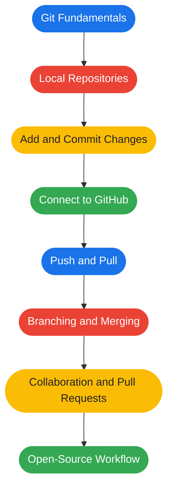

<div align="center">


<br/>


<br/><br/>

<a href="#the-mission"></a>
<a href="#the-stack"></a>
<a href="#the-roadmap"></a>
<a href="#progress"></a>
<a href="#command-playbook"></a>
<a href="#the-method"></a>

</div>

<br/>

## The Mission

Welcome to **GTI | Git & GitHub Learn Path**, my hands-on journey to mastering Git, GitHub and modern version-control workflows.

This repository documents my progress as I learn the tools developers use to manage code, track changes, collaborate with teams and contribute to open-source projects.

> [!IMPORTANT]
> **The goal:** understand the workflow, practise every command and build confidence through consistent hands-on learning.

<table align="center">
  <tr>
    <td align="center" width="25%"><b>01</b><br/>Learn the concept</td>
    <td align="center" width="25%"><b>02</b><br/>Run the command</td>
    <td align="center" width="25%"><b>03</b><br/>Verify the result</td>
    <td align="center" width="25%"><b>04</b><br/>Build the habit</td>
  </tr>
</table>

## The Stack

<div align="center">


</div>

<br/>

| Tool | Role in this journey |
|:--|:--|
| **Git** | Track changes and maintain project history |
| **GitHub** | Host repositories and collaborate online |
| **Ubuntu Linux** | Primary learning environment |
| **Bash** | Run commands and navigate the terminal |
| **Python** | Practise version control with real code files |
| **VS Code** | Edit and manage code |

## The Roadmap



## Progress

<div align="center">


</div>

<br/>

**Foundations (done)**

- [x] Check Git installation on Ubuntu
- [x] Configure Git username and email
- [x] Initialize a local repository
- [x] Create a Python file
- [x] Stage changes using `git add`
- [x] Create the first commit
- [x] Configure a GitHub remote
- [x] Authenticate using GitHub CLI
- [x] Push the first commit to GitHub

**Up next**

- [ ] Understand `git status` and `git diff` in depth
- [ ] Practise editing, staging, committing and pushing
- [ ] Learn branches and merging
- [ ] Learn pull requests and collaboration
- [ ] Practise resolving merge conflicts
- [ ] Explore open-source contribution workflows

## Command Playbook

> [!TIP]
> Open each section below to see the commands. Read what a command does before you run it.

<details>
<summary><b>Setup (one time)</b></summary>

<br/>

```bash
# Tell Git who you are
git config --global user.name "Your Name"
git config --global user.email "you@example.com"

# Make new repositories start on main (matches GitHub)
git config --global init.defaultBranch main

# Verify your configuration
git config --list
```

</details>

<details open>
<summary><b>The daily loop</b></summary>

<br/>

```bash
# Initialize a repository
git init

# Check what changed
git status

# See the exact line-by-line changes
git diff

# Stage a file
git add hello.py

# Commit staged changes
git commit -m "Describe your changes"

# View recent history
git log --oneline
```

</details>

<details>
<summary><b>Connect to GitHub</b></summary>

<br/>

```bash
# Make sure your local branch is called main
git branch -M main

# Link your local repository to GitHub
git remote add origin <repository-url>

# Verify the remote
git remote -v

# Push and set the upstream branch
git push -u origin main

# Get the latest changes from GitHub
git pull origin main

# Copy an existing repository
git clone <repository-url>
```

</details>

<details>
<summary><b>Branching</b></summary>

<br/>

```bash
# Create and switch to a new branch
git switch -c feature-name

# List all branches
git branch

# Switch back to main
git switch main

# Merge a branch into the current one
git merge feature-name
```

</details>

## The Method


I believe in understanding what a command does rather than blindly copying it. Every exercise should strengthen my practical knowledge and prepare me for real software development workflows.

<br/>

<div align="center">

<a href="https://github.com/sree77rag">
  
</a>

<br/><br/>

**One repository. One learning journey. One commit at a time.**

</div>


