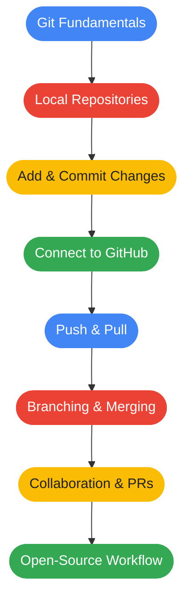
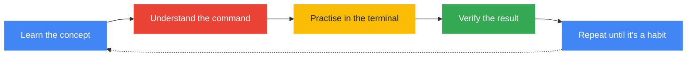

<p align="center">
  
</p>

<h1 align="center">
  <span style="color:#4285F4">G</span><span style="color:#EA4335">T</span><span style="color:#FBBC05">I</span> | Git &amp; GitHub Learn Path
</h1>

<p align="center">
  
</p>

<p align="center">
  
  
  
  
</p>

---

## 🔵 01 — The Mission

Welcome to **GTI GitHub Learn Path**, my hands-on journey to mastering Git, GitHub, and modern version-control workflows.

This repository documents my progress as I learn the tools developers use to manage code, track changes, collaborate with teams, and contribute to open-source projects.

> **The goal:** Understand the workflow, practise every command, and build confidence through consistent hands-on learning.

## 🔴 02 — The Technology

<p align="center">
  
</p>

| Technology | Purpose |
|---|---|
| Git | Track changes and maintain project history |
| GitHub | Host repositories and collaborate online |
| Ubuntu Linux | Primary learning environment |
| Bash | Run commands and navigate the terminal |
| Python | Practise version control with code files |
| VS Code | Edit and manage code |

## 🟡 03 — The Learning Path



## 🟢 04 — Progress Log

- [x] Check Git installation on Ubuntu
- [x] Configure Git username and email
- [x] Initialize a local repository
- [x] Create a Python file
- [x] Stage changes using `git add`
- [x] Create the first commit
- [x] Configure a GitHub remote
- [x] Authenticate using GitHub CLI
- [x] Push the first commit to GitHub
- [ ] Understand `git status` and `git diff` in depth
- [ ] Practise editing, staging, committing, and pushing
- [ ] Learn branches and merging
- [ ] Learn pull requests and collaboration
- [ ] Practise resolving merge conflicts
- [ ] Explore open-source contribution workflows

## 🔵 05 — Essential Commands

```bash
# Initialize a repository
git init

# Rename the default branch to main (matches GitHub's default)
git branch -M main

# Check repository status
git status

# See exactly what changed
git diff

# Stage changes
git add hello.py

# Commit staged changes
git commit -m "Describe your changes"

# View recent commits
git log --oneline

# Connect to a remote repository
git remote add origin <repository-url>

# View configured remotes
git remote -v

# Push commits to GitHub
git push -u origin main

# Get the latest changes from GitHub
git pull origin main

# Copy an existing repository
git clone <repository-url>

# Create and switch to a new branch
git switch -c feature-name
```

## 🔴 06 — My Learning Philosophy



I believe in understanding what a command does rather than blindly copying it. Every exercise should strengthen my practical knowledge and prepare me for real software development workflows.

## 🟡 07 — Follow the Journey

<p align="center">
  <a href="https://github.com/sree77rag">
    
  </a>
</p>

<p align="center">
  <b>One repository. One learning journey. One commit at a time.</b>
</p>

<p align="center">
  
</p>
